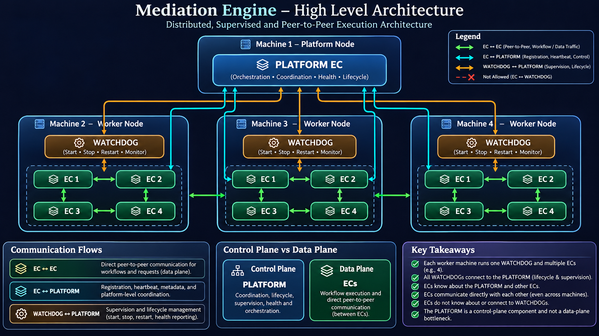
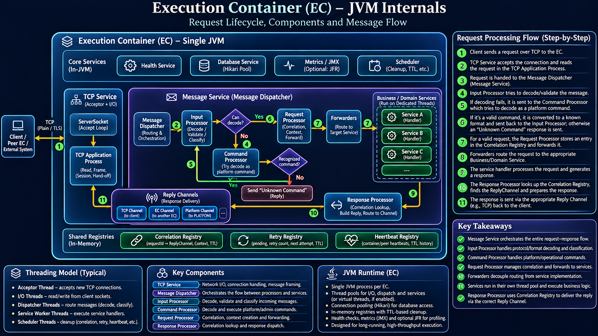
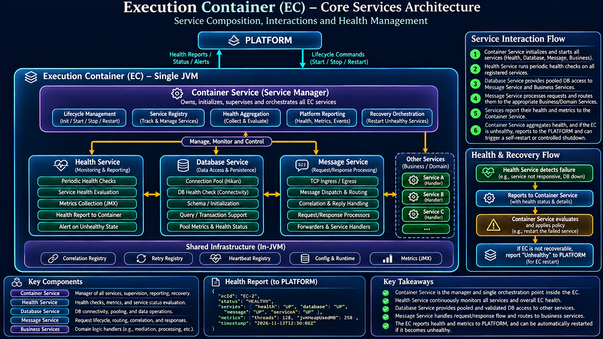

# Mediation Engine

A distributed, JVM-based mediation platform built around independently executing **Execution Containers (ECs)**, a central **PLATFORM** control plane, and machine-local **WATCHDOG** supervisors.

This README describes the architecture at three levels:

1. The distributed deployment model across machines.
2. The internal request/response lifecycle inside an Execution Container.
3. The core services that make up and manage an Execution Container.

> **Architecture note:** This document reflects the architecture and component responsibilities discussed during the design of this project. Where implementation details may still evolve, the description focuses on the intended responsibility and interaction boundary rather than prescribing an unverified implementation detail.

---

## Table of contents

- [Architecture at a glance](#architecture-at-a-glance)
- [1. Distributed deployment architecture](#1-distributed-deployment-architecture)
- [2. Execution Container: one JVM](#2-execution-container-one-jvm)
- [3. Request lifecycle inside the Message Service](#3-request-lifecycle-inside-the-message-service)
- [4. Core Execution Container services](#4-core-execution-container-services)
  - [Container Service](#container-service)
  - [Health Service](#health-service)
  - [Database Service](#database-service)
  - [Message Service](#message-service)
  - [Business and domain services](#business-and-domain-services)
  - [TCP Service](#tcp-service)
- [5. Registries and shared in-memory infrastructure](#5-registries-and-shared-in-memory-infrastructure)
- [6. Threading and execution model](#6-threading-and-execution-model)
- [7. Health reporting and recovery](#7-health-reporting-and-recovery)
- [8. Architectural boundaries and design principles](#8-architectural-boundaries-and-design-principles)
- [9. End-to-end request example](#9-end-to-end-request-example)
- [10. Further architecture diagrams](#10-further-architecture-diagrams)

---

## Architecture at a glance

The Mediation Engine separates **platform-level orchestration** from **container-level execution** and **peer-to-peer message processing**.

- **PLATFORM** coordinates the distributed runtime and owns platform-level lifecycle and supervision decisions.
- Each worker machine runs a **WATCHDOG** and one or more **Execution Containers**.
- Each **Execution Container (EC)** runs as an independent JVM process.
- ECs can communicate directly with other ECs, including ECs on other machines.
- WATCHDOGs communicate with PLATFORM for supervision and lifecycle operations. ECs do not communicate with WATCHDOGs.
- Inside an EC, the **Container Service** manages the lifecycle and health of the EC's services.
- The **Message Service** coordinates the request/response pipeline, while dedicated services and handlers execute domain work.

The PLATFORM is a control-plane component. It should not become a proxy or bottleneck for ordinary EC-to-EC workflow traffic.

---

## 1. Distributed deployment architecture



### Machines and processes

A representative deployment contains:

| Machine | Components | Responsibility |
|---|---|---|
| Platform node | PLATFORM EC | Distributed coordination, lifecycle orchestration, health aggregation and platform-level management |
| Worker node | One WATCHDOG + multiple EC JVMs | Local process supervision and independent request/workflow execution |
| Additional worker nodes | One WATCHDOG + multiple EC JVMs | Horizontal execution capacity and peer communication |

The diagram uses three worker machines with four ECs each as an example. The number of machines and ECs per machine is a deployment choice, not a fixed architectural limit.

### Communication relationships

#### EC ↔ EC: peer-to-peer data communication

ECs communicate directly with one another for requests, workflows and other application-level traffic. This communication can cross machine boundaries.

Ordinary workflow traffic should not be routed through PLATFORM. Keeping the data path direct avoids turning PLATFORM into a throughput bottleneck and separates application execution from platform coordination.

#### EC ↔ PLATFORM: platform coordination

ECs communicate with PLATFORM for platform-level concerns such as registration, heartbeats, metadata, health reporting and coordination.

The exact messages and protocol can evolve, but the boundary is important: ECs know about PLATFORM; they do not need to know about WATCHDOG processes.

#### WATCHDOG ↔ PLATFORM: process supervision

Each worker machine has a WATCHDOG responsible for supervising its local EC processes. WATCHDOG communicates with PLATFORM to receive or report lifecycle and supervision information, such as start, stop, restart and process status.

#### EC ↛ WATCHDOG: intentionally absent

An EC does not address, depend on, or communicate with a WATCHDOG. WATCHDOG ownership is a deployment and supervision concern, not part of the EC application data path.

---

## 2. Execution Container: one JVM



An Execution Container is an independent JVM process. It hosts the services, processors, registries, thread pools and runtime infrastructure needed to execute work.

At a high level, an EC contains:

- **TCP Service** — network listener, connection acceptance and socket I/O.
- **Message Service** — request/response orchestration and dispatch.
- **Container Service** — lifecycle and service management within the EC.
- **Health Service** — periodic health checks, health evaluation and reporting.
- **Database Service** — managed database connectivity and pooled access.
- **Business/domain services** — application-specific work performed by service handlers.
- **Shared in-memory infrastructure** — correlation, retry and heartbeat registries, configuration and metrics.
- **Scheduler and runtime utilities** — periodic cleanup, TTL expiry, health cycles and other scheduled work.

The JVM is the process boundary for an EC. A failure severe enough to terminate that JVM affects all services hosted inside that EC, which is why service health, process supervision and platform-level recovery are separate but cooperating responsibilities.

---

## 3. Request lifecycle inside the Message Service

The following describes the intended request path for a request arriving over TCP. The same Message Service architecture can support other reply channels, so TCP is only one possible ingress and egress mechanism.

### Request path

1. **Client sends a message.** A client, peer EC or external system sends a request over a supported transport, such as TCP.
2. **TCP Service accepts and reads.** The TCP listener accepts the connection. The TCP application process handles connection I/O, reads the incoming data and hands the message into the application pipeline.
3. **Message Dispatcher receives the message.** The dispatcher (the orchestration entry point of the Message Service) hands the incoming message to the Input Processor.
4. **Input Processor decodes and classifies.** It attempts to decode, validate and classify the incoming message into the engine's internal representation.
5. **Command Processor handles command fallback.** If the Input Processor cannot decode the input as a normal request, it gives the input to the Command Processor to check whether it is a recognized platform or operational command.
6. **Command result returns to the input path.** If recognized, the command is converted into a representation the Input Processor understands and is routed back through that path. If it is not recognized, the engine generates an `Unknown Command` response.
7. **Request Processor establishes request context.** For a valid request, the Request Processor creates or records the correlation context, including the reply channel needed to return the response.
8. **Forwarders route the request.** Dedicated forwarders select the appropriate target service and deliver the request to it.
9. **Service executes the work.** The target service accepts the work on its execution mechanism, invokes the appropriate handler and produces a result or response.
10. **Response Processor resolves the reply destination.** The Response Processor uses the correlation information to find the original reply channel and prepares the outgoing response.
11. **Reply Channel delivers the response.** The response is sent through the recorded channel, such as the original TCP connection, an EC-to-EC channel, a PLATFORM channel or another supported reply mechanism.

### Why the correlation registry matters

The service that produces a response does not need to know how the original request arrived. It produces a response for the Message Service's response path. The Response Processor resolves the original request context and its `ReplyChannel`, then dispatches the response through that abstraction.

This decouples business processing from transport-specific response delivery.

### Unknown command path

If neither the Input Processor nor the Command Processor can interpret the incoming input, the engine returns an `Unknown Command` response through the appropriate reply path. The request should not proceed into normal business-service forwarding.

---

## 4. Core Execution Container services



The EC's services have distinct responsibilities. The **Container Service** is the in-process manager of these services; it is not a replacement for PLATFORM or WATCHDOG.

### Container Service

The Container Service is the service manager inside an EC. It owns the lifecycle and coordination of the EC's registered services.

Its responsibilities include:

- Initializing and starting the services that belong to the EC.
- Maintaining the service registry and service lifecycle state.
- Coordinating service shutdown and restart operations.
- Collecting health status and relevant service metrics.
- Aggregating service-level health into an EC-level health view.
- Applying local recovery policy where a service can be recovered independently.
- Reporting EC health and relevant diagnostic information to PLATFORM.
- Handling platform lifecycle commands that are directed to the EC.

The Container Service is the internal management point for EC services. It should not become a general-purpose message broker for application traffic.

#### Service health versus EC health

A single service can be unhealthy while the JVM remains operational. The Container Service can evaluate whether the affected service can be restarted locally or whether the overall EC is unhealthy and requires platform-level intervention.

If the EC itself is unhealthy or cannot recover safely, the Container Service reports that condition to PLATFORM. PLATFORM can then coordinate process-level recovery through the relevant WATCHDOG.

### Health Service

The Health Service monitors the health of the EC and its registered services.

Typical responsibilities include:

- Running periodic health-check cycles.
- Checking whether registered services are responsive and operational.
- Collecting service health information and relevant metrics.
- Checking dependencies where supported, such as database connectivity.
- Maintaining health status and diagnostic details.
- Reporting health information to the Container Service.
- Detecting unhealthy conditions and raising them for evaluation.

The Health Service observes and reports. It should not independently own the entire service lifecycle or make platform-level process-restart decisions. The Container Service coordinates local service management, and PLATFORM coordinates distributed process supervision.

### Database Service

The Database Service provides controlled access to the configured database.

Typical responsibilities include:

- Creating and managing the configured data source.
- Providing pooled connections through HikariCP.
- Exposing a consistent database-access facility to services that need persistence.
- Performing database connectivity and health checks.
- Managing initialization and schema-related setup where that responsibility is configured.
- Exposing relevant pool and connection health metrics.
- Handling data-access lifecycle during EC startup and shutdown.

Other services should use the Database Service's managed data-access facilities rather than each creating an unrelated connection pool. This centralizes connection configuration, resource ownership and database health visibility.

The EC may use an embedded database for local runtime metadata during development or deployment, while application/business persistence can use an external database such as PostgreSQL or Oracle, depending on configuration.

### Message Service

The Message Service is the EC's request/response orchestration layer.

Its responsibilities include:

- Receiving messages handed off by ingress components.
- Dispatching messages through the input-processing pipeline.
- Decoding, validating and classifying incoming messages.
- Routing operational commands through the command-processing path.
- Creating request correlation context.
- Recording the reply channel associated with each request.
- Forwarding valid requests to the appropriate service.
- Processing service responses and resolving their original request context.
- Delivering responses through the correct reply channel.
- Coordinating retry and pending-delivery behavior where applicable.

The Message Service owns message-flow orchestration, not the business logic of every service. It should route work to the appropriate service rather than embedding domain-specific behavior into the dispatcher.

### Business and domain services

Business/domain services implement the actual application work. Examples include mediation, file processing, workflow execution or other domain-specific capabilities.

A typical service:

1. Receives a request routed by its forwarder.
2. Accepts the work using its own execution mechanism or thread pool.
3. Invokes the appropriate handler.
4. Performs the requested business operation.
5. Produces a response or result.
6. Hands the response back to the Message Service's response path.

Services should own their domain logic and execution concerns. They should not need to know the transport details of the original request.

### TCP Service

The TCP Service is a transport adapter. It accepts network connections, performs socket I/O and hands incoming messages to the Message Service.

Typical responsibilities include:

- Binding and listening on the configured TCP port.
- Accepting client connections.
- Managing connection-level read/write operations.
- Framing incoming messages according to the configured protocol.
- Handing complete messages to the Message Service.
- Providing a TCP-backed `ReplyChannel` for responses.
- Tracking connection lifecycle and relevant transport metrics.

The TCP Service should not implement business routing or domain processing. Its responsibility ends at transport ingress/egress and the handoff to the message pipeline.

---

## 5. Registries and shared in-memory infrastructure

The EC uses in-memory registries to coordinate asynchronous request/response work and runtime state.

### Correlation Registry

The Correlation Registry associates an in-flight request with the information needed to complete it.

A typical entry may contain:

- Request or correlation identifier.
- Original `ReplyChannel`.
- Request context or metadata needed for response handling.
- Creation time and expiry/TTL information.

When a response arrives, the Response Processor looks up the correlation entry, retrieves the reply channel and delivers the response. Entries must be removed after completion or expiry so abandoned requests do not accumulate indefinitely.

### Retry Registry

The Retry Registry tracks deliveries or requests that may be retried.

A typical pending-delivery entry may contain:

- Delivery or correlation identifier.
- Pending response/delivery state.
- Retry count and next-attempt information.
- Expiry/TTL information.

Retry policy should be bounded and explicit. Expired or completed entries must be cleaned up, and retry behavior should avoid creating unbounded work during downstream failures.

### Heartbeat Registry

The Heartbeat Registry maintains recent heartbeat information for containers or peers.

It can support:

- Last-seen timestamps.
- Heartbeat history.
- TTL-based expiry.
- Peer/container liveness evaluation.
- Health diagnostics and reporting.

Heartbeat information is an observation of liveness, not proof that every application operation is healthy. It should be interpreted alongside service-level health checks and other signals.

### Metrics and configuration

Runtime metrics and configuration are shared infrastructure concerns. Metrics can expose service health, request counts, failures, queue activity, thread-pool behavior and JVM characteristics. Configuration supplies the runtime settings used to initialize services and their dependencies.

---

## 6. Threading and execution model

The EC is one JVM process, but its services can use separate execution resources so that network I/O, dispatch, scheduled maintenance and business work do not all compete in one execution path.

A typical logical breakdown is:

| Execution resource | Responsibility |
|---|---|
| TCP acceptor | Accepts new socket connections |
| TCP I/O workers | Reads from and writes to client sockets |
| Message/dispatcher workers | Dispatches and processes incoming messages |
| Service workers | Executes service handlers and business logic |
| Scheduler threads | Runs periodic health checks, TTL cleanup and retry-related tasks |
| JVM runtime threads | Garbage collection, JIT compilation and other JVM-managed work |

The exact thread pools and sizing are configuration and implementation decisions. The important design goal is isolation of responsibilities, bounded resource usage and predictable overload behavior.

### Backpressure and failure handling

A long-running EC must handle load beyond its instantaneous processing capacity. Queues, executors and connection limits should be bounded or governed by explicit admission policies. Rejected work should be handled deliberately—for example, with a controlled error response, retry policy or connection-level failure—rather than allowing resource exhaustion to cascade through the JVM.

Virtual threads can be useful for suitable blocking workloads, but they do not remove the need to bound external resources such as database connections, sockets, memory, downstream capacity and queued work.

---

## 7. Health reporting and recovery

Health management is layered:

1. **Health Service observes.** It runs checks and gathers service-level health and metrics.
2. **Container Service evaluates.** It aggregates the service results and determines whether local recovery is appropriate.
3. **Container Service reports.** It sends the EC's health state and diagnostics to PLATFORM.
4. **PLATFORM coordinates.** If the EC is unhealthy or cannot recover locally, PLATFORM coordinates the process-level action.
5. **WATCHDOG supervises the process.** The machine-local WATCHDOG performs the relevant process lifecycle operation under PLATFORM's supervision model.

This separates three different concerns:

- Detecting that something is wrong.
- Deciding what recovery action is appropriate.
- Executing process-level lifecycle operations.

A service restart inside a healthy JVM is different from restarting the entire EC process. The latter affects every service hosted by that JVM and should be coordinated as a process lifecycle operation.

### Example health report

The following is illustrative only; actual field names and payload formats are defined by the implementation:

```json
{
  "ecId": "EC-2",
  "status": "HEALTHY",
  "services": {
    "health": "UP",
    "database": "UP",
    "message": "UP"
  },
  "metrics": {
    "activeThreads": 128,
    "heapUsedMb": 258
  },
  "timestamp": "2026-11-13T12:30:00Z"
}
```

A report should include enough diagnostic information for PLATFORM to make an informed supervision decision without requiring ordinary application traffic to pass through PLATFORM.

---

## 8. Architectural boundaries and design principles

### Control plane and data plane are separate

- **Control plane:** PLATFORM, WATCHDOG supervision and lifecycle coordination.
- **Data plane:** direct EC-to-EC communication and request/workflow execution.

PLATFORM coordinates the system; it should not proxy routine application messages.

### Keep service responsibilities narrow

- TCP Service owns transport.
- Message Service owns message orchestration.
- Processors own their specific stages of the message lifecycle.
- Forwarders own target-service routing.
- Business services own domain logic.
- Database Service owns managed database access.
- Health Service observes and reports health.
- Container Service owns in-process service management.

### Decouple request processing from response transport

The `ReplyChannel` abstraction allows the response path to return a result without coupling business handlers to TCP sockets or any one transport.

### Separate service recovery from process recovery

A failed service may be recoverable inside the EC. A failed or unrecoverable EC requires process-level supervision coordinated by PLATFORM and carried out through WATCHDOG.

### Design for long-running operation

Registries, executors, connection pools, schedulers and network resources need explicit lifecycle ownership, bounded capacity, expiry/cleanup policies and observable metrics.

---

## 9. End-to-end request example

Consider a request arriving at EC-A over TCP and being handled by a business service inside that EC.

```text
Client / Peer
    |
    v
TCP Service
    |
    v
TCP Application Process
    |
    v
Message Dispatcher
    |
    v
Input Processor
    |
    +---- cannot decode ----> Command Processor
    |                             |
    |                             +---- unknown ----> Unknown Command Reply
    |                             |
    |                             +---- recognized -> Input Processor
    |
    v
Request Processor
    |
    +---- create correlation entry (request -> ReplyChannel/context)
    |
    v
Forwarder
    |
    v
Target Business Service
    |
    v
Service Handler
    |
    v
Response
    |
    v
Response Processor
    |
    +---- lookup correlation entry
    +---- obtain original ReplyChannel
    +---- complete/remove correlation state
    |
    v
ReplyChannel (TCP / EC / PLATFORM / other supported channel)
    |
    v
Original requester
```

The key property is that the business handler does not need to know whether the original request came from TCP, another EC or another supported channel. The Message Service preserves the reply context and resolves the destination when the response is ready.

---

## 10. Further architecture diagrams

The following diagrams are included in this repository under `docs/images/`.

### Distributed deployment


Shows PLATFORM, worker machines, WATCHDOGs, ECs and the separation between peer-to-peer communication and supervision.

### Execution Container JVM internals


Shows the TCP-to-message-to-service request path, response correlation, reply channels, registries and a representative threading model.

### Core services and health management


Shows Container Service, Health Service, Database Service, Message Service, business services and the health/recovery relationship with PLATFORM.

---

## Summary

The Mediation Engine is designed as a distributed runtime in which each Execution Container is an independently running JVM with its own service lifecycle, message-processing pipeline, registries and execution resources.

PLATFORM coordinates the distributed system. WATCHDOG supervises local EC processes. Container Service manages the services inside an EC. Message Service orchestrates request/response processing. Domain services execute the actual work. Direct EC-to-EC communication keeps the data plane independent of the platform control plane.

The result is a separation of concerns across **deployment supervision, container management, message orchestration and business execution**—a foundation for scaling the runtime across machines while keeping individual components independently manageable.
