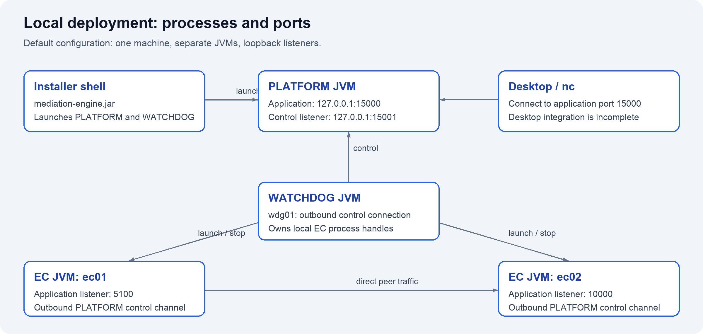
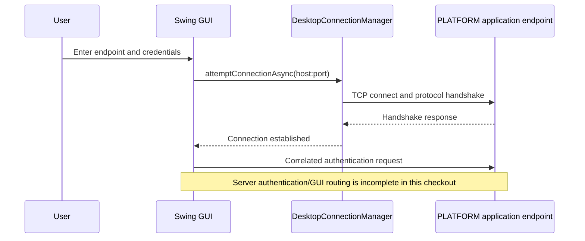
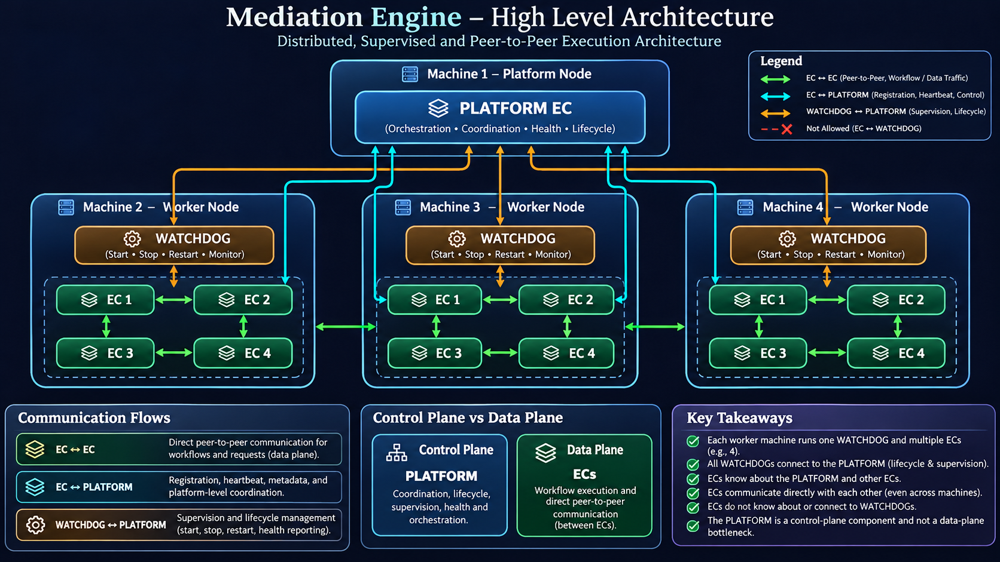
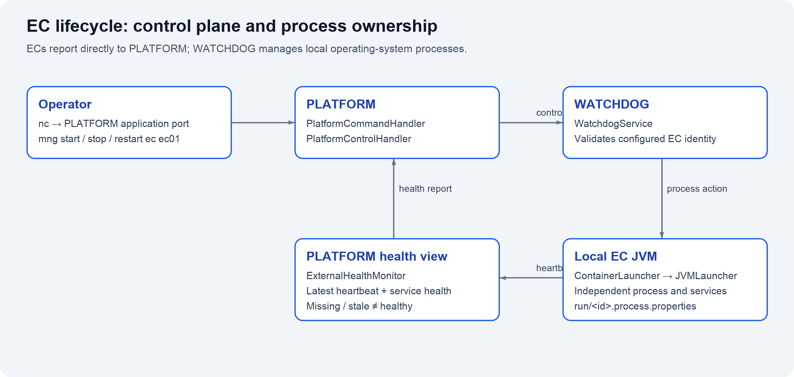
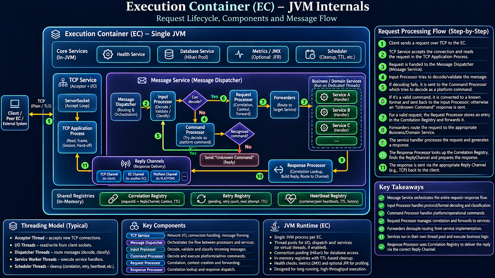
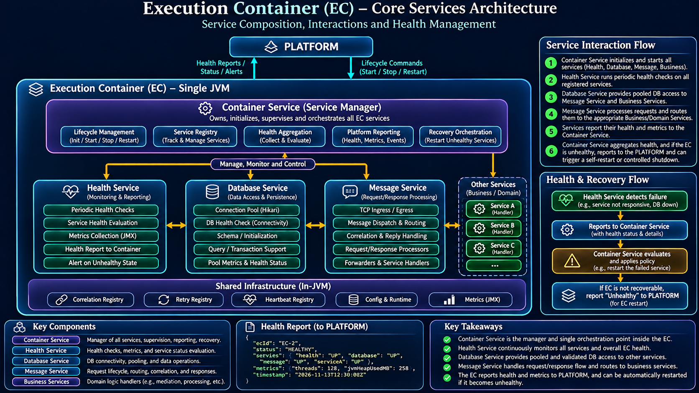
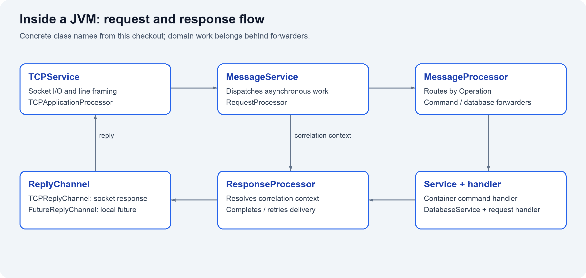
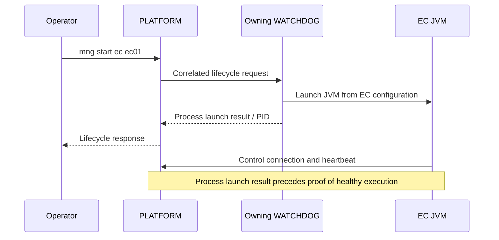

# Mediation Engine

Mediation Engine is a Java 25 runtime built around a **PLATFORM** control plane, machine-local **WATCHDOG** supervisors, and independent **Execution Container (EC)** JVMs. It separates process supervision, service lifecycle management, TCP transport, asynchronous message routing, health reporting, and database access.

This guide covers building and installing the runtime, launching services, connecting the desktop client, managing ECs, and understanding the code internally. Commands and defaults refer to the configuration committed in this repository.

> **Implementation status:** The platform/EC/watchdog runtime and management command paths are implemented. The Swing desktop contains connection and login code, but GUI integration is in progress: `GUIForwarder.forward()` is empty, and the platform initializer does not wire the authentication or diagnostics forwarders. A successful TCP connection does not imply a working login or dashboard. Some companion documents describe a broader target architecture; the implementation notes below identify the current boundaries.

## Contents

- [1. Runtime overview](#1-runtime-overview)
- [2. Prerequisites and build](#2-prerequisites-and-build)
- [3. Install from source](#3-install-from-source)
- [4. Launch and verify the services](#4-launch-and-verify-the-services)
- [5. Desktop GUI and its PLATFORM connection](#5-desktop-gui-and-its-platform-connection)
- [6. Configuration guide](#6-configuration-guide)
- [7. Overall distributed architecture](#7-overall-distributed-architecture)
- [8. Internal JVM architecture](#8-internal-jvm-architecture)
- [9. Services and their responsibilities](#9-services-and-their-responsibilities)
- [10. Message processing in detail](#10-message-processing-in-detail)
- [11. Registries, threading, and capacity](#11-registries-threading-and-capacity)
- [12. Health, recovery, and process identity](#12-health-recovery-and-process-identity)
- [13. Operations and upgrades](#13-operations-and-upgrades)
- [14. Troubleshooting](#14-troubleshooting)
- [15. Tests and source map](#15-tests-and-source-map)
- [16. Documentation and diagram index](#16-documentation-and-diagram-index)

## 1. Runtime overview

An **Execution Container** here means an application JVM, not a Docker container. Multiple ECs can run on one machine, each with its own services, application port, memory, and failure boundary. The repository builds executable JARs and optionally a macOS application bundle; it does not supply Docker/OCI images or a Compose deployment.

| Component | Purpose | Default identity / endpoint |
| --- | --- | --- |
| Installer shell | Validates installation paths and launches PLATFORM/WATCHDOG | `java -jar mediation-engine.jar` |
| PLATFORM | Coordinates configured ECs, receives health, routes lifecycle operations to watchdogs | `platform`; application `127.0.0.1:15000`, control `127.0.0.1:15001` |
| WATCHDOG | Starts, stops, restarts, and reattaches to local EC processes | `wdg01`; connects outbound to PLATFORM control port |
| Execution Container 1 | Independent service execution JVM | `ec01`; application `127.0.0.1:5100` |
| Execution Container 2 | Independent service execution JVM | `ec02`; application `127.0.0.1:10000` |
| Desktop GUI | Swing client connecting to PLATFORM's application endpoint | `127.0.0.1:15000`; integration in progress |
| H2 database | File-backed platform metadata and configured tables | `data/fileprocessor` beneath installation home |



The control port `15001` in EC and watchdog configurations identifies **PLATFORM's control listener**. It does not mean every JVM binds its own listener on that port.

## 2. Prerequisites and build

Use a full **JDK 25**. The project requests Java 25 through Gradle toolchains; the macOS packaging script also requires `jpackage`. The checked-in Gradle wrapper selects **Gradle 9.1.0**, so a separate Gradle installation is unnecessary. The first build requires access to the Gradle distribution and Maven Central. Bash is needed for the deployment scripts; `nc` is useful for management commands.

On macOS, select an installed JDK 25:

```sh
export JAVA_HOME="$(/usr/libexec/java_home -v 25)"
export PATH="$JAVA_HOME/bin:$PATH"
java -version
./gradlew --version
```

On Linux or another platform, set `JAVA_HOME` to your JDK 25 directory and add its `bin` directory to `PATH`. The Java build is separate from the macOS-specific packaging script.

From the repository root:

```sh
./gradlew clean test shadowJar desktopJar
```

| Artifact | Entry point | Use |
| --- | --- | --- |
| `build/libs/mediation-engine.jar` | `org.prats.Main` | Installer shell; also contains PLATFORM, WATCHDOG, and EC initializers |
| `build/libs/mediation-desktop.jar` | `org.prats.desktop.DesktopApplication` | Standalone Swing login client |

Both are shaded JARs containing their dependencies. Building them does not install configuration or launch any services.

The main dependencies are Typesafe Config for HOCON, Jackson for message serialization, HikariCP for connection pooling, H2 for local persistence, Commons CSV for CSV parsing, and Logback for logging. See [build.gradle](build.gradle) for exact versions.

## 3. Install from source

### 3.1 Create an installation home

The source checkout and runtime installation are separate directories. These examples use the deployment scripts' default destination:

```sh
export MEDIATION_INSTALL_DIR="$HOME/Desktop/MediationEngine"
mkdir -p "$MEDIATION_INSTALL_DIR/conf" "$MEDIATION_INSTALL_DIR/data" "$MEDIATION_INSTALL_DIR/logs" "$MEDIATION_INSTALL_DIR/run"
cp build/libs/mediation-engine.jar build/libs/mediation-desktop.jar "$MEDIATION_INSTALL_DIR/"
bash ./deploy-conf.sh
```

Run these commands from the repository root after building. `deploy-conf.sh` honors `MEDIATION_INSTALL_DIR`; if unset, it uses `~/Desktop/MediationEngine`.

The configuration script copies the source configuration tree and installer path configuration. **Rerunning it overwrites matching installed configuration files.** Preserve local changes before using it during an upgrade. It does not deploy JARs or erase the runtime's data/log directories.

### 3.2 Installation layout

```text
MediationEngine/
├── mediation-engine.jar
├── mediation-desktop.jar
├── conf/
│   ├── installer/allFilePath.conf
│   ├── applicationConfigs/application.conf
│   ├── containerConfigs/
│   │   ├── platformConfigs/platform.conf
│   │   ├── watchdogConfigs/wdg1.conf
│   │   └── ecConfigs/
│   │       ├── ec1.conf
│   │       └── ec2.conf
│   └── databaseConfigs/
│       ├── table_database.conf
│       ├── tableConfigs/
│       └── tabConfigs/
├── data/       # H2 files and persistent runtime data
├── logs/       # Application logs and configured JVM diagnostic files
└── run/        # EC process identity files, created at runtime
```

`ApplicationPaths` selects home from `-Dmediation.home`, or from the packaged JAR's parent directory when the property is absent. Home must exist. Relative application paths resolve beneath it; paths escaping it are rejected. Keep configuration, referenced JARs, and runtime files inside this home.

### 3.3 Optional macOS application bundle

Once the installation directory exists:

```sh
bash ./deploy-local.sh
```

This script selects Java 25, runs `clean test shadowJar desktopJar`, builds a `jpackage --type app-image` bundle with a bundled runtime, copies both JARs into the installation, and updates `/Applications/Mediation Engine.app`.

To use different destinations:

```sh
MEDIATION_INSTALL_DIR="$HOME/Desktop/MediationEngine" \
MEDIATION_APP_DIR="$HOME/Applications/Mediation Engine.app" \
bash ./deploy-local.sh
```

The destination's parent directory must exist and be writable. This is a macOS packaging path, not a general Linux installer. The script does not deploy configuration, run `integrationTest`, or restart running services.

## 4. Launch and verify the services

### 4.1 Start the installer shell

```sh
cd "$MEDIATION_INSTALL_DIR"
java -Dmediation.home="$MEDIATION_INSTALL_DIR" -jar mediation-engine.jar
```

If using a fresh terminal, set `MEDIATION_INSTALL_DIR` again before running this command.

At the installer prompt, enter these commands **one at a time**:

```text
mng paths
mng validate
mng start platform
mng start watchdog
```

Start PLATFORM first, then WATCHDOG. The installer launches separate JVMs using each configuration's main class and JVM arguments. Child processes inherit the installer's I/O and use the installation home as their working directory. Wait for successful startup and inspect logs before continuing. Installation validation checks required resources and files; it is not an end-to-end health check.

The installer can then be closed with:

```text
mng exit
```

This exits the shell; it does not explicitly stop the JVMs it launched. Terminal/session supervisors can still affect process lifetimes, so use an OS service manager for unattended operation.

> If launchd or another service manager already runs PLATFORM or WATCHDOG, manage those existing processes instead of launching duplicates. The installer is a launcher, not a check for an already-running deployment.

### 4.2 Connect to PLATFORM and start ECs

In another terminal:

```sh
nc 127.0.0.1 15000
```

Enter runtime commands:

```text
mng help
mng status
mng start ec ec01
mng start ec ec02
```

PLATFORM routes EC lifecycle requests to the watchdog configured to own that EC. WATCHDOG launches the EC with its configured Java arguments and records its process identity. ECs then establish their own PLATFORM control connections and begin reporting health.

Starting WATCHDOG does not itself mean that all configured ECs have started. Use the explicit EC commands and verify the resulting state.

### 4.3 Verify the runtime

After allowing at least one heartbeat interval (15 seconds):

```text
mng health report platform
mng health report ec01
mng health report ec02
```

Check that the platform reports its services and that EC reports contain recent heartbeat data. A launched PID, an open port, and a healthy service report are different observations; verify the latter as well.

To inspect an EC directly:

```sh
nc 127.0.0.1 5100
```

```text
mng status
mng health report ec01
```

### 4.4 Installer commands versus runtime commands

These are separate interfaces:

| Interface | Commands | Scope |
| --- | --- | --- |
| Installer shell | `mng help`, `mng paths`, `mng validate`, `mng start platform`, `mng start watchdog`, `mng exit` | Installation and launching supervisor JVMs |
| PLATFORM application TCP connection | `mng start ec <id>`, `mng stop ec <id>`, `mng restart ec <id>` | EC process lifecycle via WATCHDOG |
| PLATFORM or direct EC application connection | `mng status`, `mng health report <id>`, `mng restart services all`, `mng shutdown services all`, `mng kill` | Connected JVM and its services, with platform-specific remote health support |

Runtime commands require the `mng` prefix. Keywords are case insensitive; use the configured case for EC IDs. `mng kill` terminates the connected JVM; `mng shutdown services all` shuts down internal services and can also remove the connection needed to manage them. A service manager may restart a terminated JVM.

## 5. Desktop GUI and its PLATFORM connection

Launch the desktop independently of the engine services:

```sh
java -jar "$MEDIATION_INSTALL_DIR/mediation-desktop.jar"
```

Or open the packaged **Mediation Engine** macOS app after running `deploy-local.sh`.

The GUI is a client of **PLATFORM**, not a watchdog or EC console. Enter PLATFORM's application endpoint, normally `127.0.0.1:15000`, in the login screen. `DesktopConnectionManager` accepts `host:port` and bracketed IPv6 endpoints such as `[::1]:15000`.



The connection manager reuses the shared `TCPService` in client-only mode: it creates an outbound connection rather than opening a local server socket. `LoginController` sequences connection, handshake, and authentication asynchronously. Responses use correlation IDs and futures; UI updates return to Swing's event-dispatch thread.

**Connection and login are separate steps.** A completed handshake confirms the transport/protocol connection. Authentication additionally requires a wired server route, a matching account schema, credential validation, and session creation. `AuthenticationHandler` and `AuthenticationService` contain server-side functionality, but `PlatformInitializer` currently does not connect that service to `MessageProcessor`. `GUIForwarder` is also a no-op. Do not assume that login, account management, a monitoring dashboard, or diagnostic actions work end to end in this revision. No ready-to-use default GUI account is documented here.

Use the TCP management interface to operate the runtime while those integration paths are being completed.

## 6. Configuration guide

Configuration uses HOCON and is external to the packaged JAR. Edit the **installed** files for the deployed runtime; editing source resources alone does not change an existing installation.

| File beneath installation home | What it controls |
| --- | --- |
| `conf/installer/allFilePath.conf` | Installer's platform, watchdog, database paths and embedded welcome/help resource names |
| `conf/containerConfigs/platformConfigs/platform.conf` | PLATFORM identity, bind addresses, ports, JVM options, database config, EC inventory, watchdog inventory |
| `conf/containerConfigs/watchdogConfigs/wdg1.conf` | WATCHDOG identity, PLATFORM control endpoint, local EC definitions, JVM options |
| `conf/containerConfigs/ecConfigs/ec1.conf` / `ec2.conf` | EC identity, application bind/port, PLATFORM endpoint, peer ECs, optional database, JVM options |
| `conf/databaseConfigs/table_database.conf` | Database URL, credentials, connection limits, table configuration paths |
| `conf/databaseConfigs/tableConfigs/*.conf` | Table identifiers, fields, types, required/primary-key metadata |
| `conf/applicationConfigs/application.conf` | Logging configuration resource; check the relevant logging code before assuming it overrides JVM properties |

### Important fields

| Field | Meaning |
| --- | --- |
| `id` | Stable configured identity used by management commands and peer registration |
| `tcp-bind-host` | Interface on which the application listener accepts connections |
| `tcp-port` | Application listener port; must be distinct for JVMs sharing a host/interface |
| `control-bind-host` | PLATFORM control listener interface |
| `platform-host` / `platform-control-port` | WATCHDOG's destination for PLATFORM control traffic |
| EC `platform-host` / `control-port` | EC's PLATFORM control destination |
| `main-class` / `class-path` | Java entry point and engine JAR path used by `ContainerLauncher` |
| `jvm-args` | Per-process heap, collector, logging, and other Java options |
| `db-configured` / `database-conf` | Whether an EC initializes its own database service and where its configuration lives |
| `ec-configs` | Configured EC/peer inventory; its role depends on the containing file |
| `watchdog-configs` | Watchdogs PLATFORM can use for EC lifecycle operations |

The supplied ECs have `db-configured = false`; PLATFORM initializes the configured H2 database. Do not give multiple JVMs the same embedded file database and assume concurrent independent ownership works. An EC needing persistence should have a deliberately configured database and storage ownership model.

The default database configuration uses `jdbc:h2:file:./data/fileprocessor`, user `sa`, an empty password, and a maximum pool size of 10. Launched engine JVMs run from application home, so that relative URL resolves under the installation. Table metadata includes batch agents and users; inspect table definitions and handler expectations when changing schemas.

### Application home and installer path override

```sh
java -Dmediation.home="$MEDIATION_INSTALL_DIR" \
     -Dmediation.paths=conf/installer/allFilePath.conf \
     -jar "$MEDIATION_INSTALL_DIR/mediation-engine.jar"
```

Use `-Dmediation.paths` for an alternative installer path configuration inside home. `org.prats.Main` launches the shell without forwarding its command-line arguments, so a positional path after `-jar` is not the documented override mechanism.

### Multi-machine configuration

The supplied configuration is a single-machine loopback deployment. To extend it:

1. Install the engine JAR, configuration, and JDK on every participating machine.
2. Assign unique EC/watchdog identities and appropriate application ports.
3. Make PLATFORM's control listener reachable from workers; change worker `platform-host` values accordingly.
4. Set EC bind addresses and peer hosts to reachable addresses where direct peer traffic is needed.
5. Keep PLATFORM's inventory and each watchdog's locally owned EC inventory consistent. PLATFORM reads configured watchdog files to build ownership information, so referenced configuration files must also exist beneath PLATFORM's home.
6. Keep each watchdog's EC launch paths valid on that worker; a remote machine cannot use a local filesystem path merely because PLATFORM knows it.
7. Start PLATFORM, then worker watchdogs, then ECs, and verify fresh health reports.

TCP is not encrypted, and management commands run without an account session. The loopback defaults are suitable for local access. Use a trusted network/tunnel or add transport security and appropriate access controls before exposing listeners remotely.

## 7. Overall distributed architecture



The image illustrates a deployment pattern; its machine/container count is not a fixed runtime requirement.

### Control plane

PLATFORM knows the configured ECs and their watchdog ownership. WATCHDOG connects to PLATFORM to receive process operations. Each EC also connects directly to PLATFORM to report health and participate in control communication.

An operator's `mng restart ec ec01` travels through PLATFORM to the owning WATCHDOG. WATCHDOG stops and relaunches the operating-system process. PLATFORM does not need to execute remote operating-system process operations itself.

### Data plane

ECs have application listeners and configured peer connections. Peer application traffic can go directly between ECs without passing through PLATFORM. PLATFORM remains the coordination point; it is not intended to proxy every domain message.

EC application code does not address WATCHDOG. WATCHDOG's process ownership and an EC's application processing are separate concerns.



### Failure boundaries

Each EC, PLATFORM, and WATCHDOG is a separate JVM. A service fault can sometimes be recovered inside its JVM. A JVM failure requires an external supervisor. Restarting an EC interrupts that EC's sockets and in-flight work; the in-memory registries are not durable request storage.

## 8. Internal JVM architecture



Initializers act as composition roots: they parse startup arguments and configuration, create registries, construct services and processors, connect forwarders/handlers, register services, and invoke the container lifecycle manager.

| Initializer | Role |
| --- | --- |
| `PlatformInitializer` | Builds platform database/message/health/transport infrastructure, external health monitoring, watchdog ownership mapping, and platform command routing |
| `ExecutionContainerInitializer` | Builds EC message/health/transport infrastructure, optional database service, peer connections, control handler, command routing, and process identity |
| `WatchdogInitializer` | Builds the local process supervisor and its outbound PLATFORM transport |

`ContainerLauncher` translates HOCON definitions into JVM and application arguments. `JVMLauncher` starts the child using the launching JVM's Java executable, adds `mediation.home`, sets the child's working directory to home, and inherits I/O. This is why selecting Java 25 before launching the installer matters.

Service instances share registries and message infrastructure **within one JVM**. They do not share Java objects across JVMs; cross-process interactions use serialized TCP messages.



The existing architecture images describe logical responsibilities. The following service descriptions distinguish concrete classes and current wiring from future domain extensions.

## 9. Services and their responsibilities

### Container Service: lifecycle ownership inside a JVM

**Classes:** `ContainerService`, `ExecutionContainerService`, `PlatformService`.

The container service manages registered services inside its JVM. It starts them, coordinates service shutdown/restart, manages internal health evaluation, and provides command handling. `ContainerServiceRegistry` records which service instances belong to that JVM.

It is the bridge between service-level health and the container's overall state. A TCP service failure and a database failure are independent observations; the manager evaluates them without treating unrelated failure counts as one service's recovery history.

`ExecutionContainerService` specializes this manager for ECs. It dispatches local commands through `ExecutionContainerCommandHandler`, passes control requests to `ECControlHandler`, and schedules health-checker evaluation and heartbeat transmission. Heartbeats contain the EC's service/overall health and go directly to PLATFORM.

`PlatformService` specializes it for the control plane. In addition to local service management, it uses `ExternalHealthMonitor`, the EC inventory, and watchdog mappings to support distributed management. Its command handler delegates EC process operations to `PlatformControlHandler`.

**Boundary:** Restarting a service is an in-process lifecycle action. Restarting an EC is an operating-system process action performed through WATCHDOG. The container manager is not the general data-plane broker for business requests.

### TCP Service: transport and connection ownership

**Class:** `TCPService`; collaborators include `TCPProtocolProcessor`, `TCPApplicationProcessor`, `TCPHandshakeManager`, and `ClientConnection`.

TCP Service owns socket transport: accepting connections when in server mode, connecting to configured peers, framing inbound lines, scheduling reads/writes, enforcing connection/frame/output limits, and closing failed or idle connections.

Application and control traffic have distinct processing paths. Application traffic is handed into the message pipeline. Protocol/control processors handle peer handshakes, correlated control exchanges, heartbeats, and lifecycle traffic according to the configured handler.

The desktop also uses this shared service in `CLIENT_ONLY` mode. Reusing transport does not cause the desktop to start an EC or database.

**Boundary:** TCP handles delivery, not SQL execution, credentials, or domain routing. A socket connection alone does not prove the remote services are healthy.

### Message Service: asynchronous orchestration

**Class:** `MessageService`; collaborators are `RequestProcessor`, `MessageProcessor`, `CommandProcessor`, and `ResponseProcessor`.

Message Service receives request/response work through the dispatcher interface and schedules it onto controlled execution resources. Request processing records a reply channel and routes by operation. Response processing finds the original request context and delivers the result without making a database or command handler own a socket.

It also drives correlation expiration and failed-response retry maintenance. Request work and response/maintenance work use separate admission resources so overloaded request handling does not consume all capacity needed to finish existing work.

**Boundary:** It orchestrates work. Domain logic belongs in the selected service/handler. The implementation uses `RequestProcessor` and `MessageProcessor`; there is no separate `InputProcessor` class in this checkout.

### Health Service: internal observation

**Class:** `HealthService`; collaborators include `HealthReportAnalyzer`, `HealthReportFormatter`, and registered `HealthCheckable` services.

Health Service collects service health and exposes a consolidated view to the container manager. Its purpose is to report whether the JVM's components are operating and provide details for diagnosis/recovery. Container managers also periodically evaluate the health checker itself, since a failed observer must not silently imply a healthy system.

The EC manager schedules heartbeat sending separately from health collection. PLATFORM receives these reports through the control plane and stores them via external monitoring infrastructure.

**Boundary:** Observation, local service lifecycle, and remote process supervision are separate layers. Health Service does not directly kill remote JVMs.

### Database Service: managed persistence

**Class:** `DatabaseService`; collaborators include `DatabaseForwarder`, `DatabaseRequestHandler`, `HikariDBConnectionPool`, `H2DatabaseResourceManager`, `H2TableInitializer`, and SQL helpers.

Database Service provides the service lifecycle/execution boundary for database work. `DatabaseForwarder` submits database operations to it; `DatabaseRequestHandler` interprets structured database requests and performs the database interaction. The Hikari pool owns reusable connections, while resource/table helpers load database/table configuration and initialize configured structures.

Operations routed here include `FETCH`, `SEARCH`, `CREATE`, `UPDATE`, and `DELETE`. Query/update results use dedicated payload records rather than arbitrary transport-specific replies. JDBC resources and connection pools must be cleaned up during shutdown.

PLATFORM initializes the configured database service. ECs initialize one only when configured to do so. The supplied resource manager and URL use H2; other databases should not be described as ready-to-use backends without implementing and validating their configuration, driver, and schema behavior.

**Boundary:** Other services should use managed database requests/resources instead of silently creating unrelated pools. The database handler does not decide how to return a TCP response.

### Authentication Service: account and session work, integration pending

**Classes:** `AuthenticationService`, `AuthenticationHandler`, `InMemorySessionManager`, `PasswordHasher`.

Authentication Service supplies the worker/lifecycle boundary for authentication. AuthenticationHandler contains credential validation, account creation, logout, and authorization-related behavior. It uses structured database requests for account data and a session manager for runtime sessions. Password hashing belongs to security code rather than the Swing UI or TCP service.

The handler recognizes login/authentication, user creation, and logout operations; account creation requires an existing privileged session. An in-memory session is process-local and does not become a durable identity store simply because accounts are persisted.

**Current wiring:** `MessageProcessor` exposes an authentication-forwarder slot, but `PlatformInitializer` does not set it or register AuthenticationService. These classes describe available implementation pieces, not a completed GUI login flow. The current sample user table also needs to be checked against the handler's expected account schema before provisioning accounts.

### WATCHDOG Service: local process supervision

**Class:** `WatchdogService`; collaborators include `ContainerLauncher`, `JVMLauncher`, and `ECProcessIdentityStore`.

WATCHDOG owns process handles for the ECs assigned to its machine. It validates lifecycle requests against its configured EC inventory, serializes local supervision work, starts EC JVMs, stops them, and performs restart as stop followed by start.

It can recover ownership of still-running ECs after a watchdog restart using verified process identities. It does not initialize the full EC database/message/health stack merely to supervise a process.

**Boundary:** WATCHDOG is not an EC application endpoint. ECs report directly to PLATFORM and do not send their domain requests to WATCHDOG. Keeping watchdog ownership separate allows a healthy EC to outlive a watchdog restart when the OS supervisor permits it.

### GUI routing and future domain services

`GUIForwarder` is the current extension point for GUI operations but its `forward()` implementation is empty. `MessageProcessor` also has optional diagnostic routing, which is not connected by the current platform initializer. There is no implemented `GUIService` or `DiagnosticsService` class in this checkout.

A future business service should provide lifecycle and health behavior, accept admitted work, run its handler, and return results through Message Service. File-processing, workflow, or mediation-specific services can fit that structure, but the generic service architecture should not be mistaken for a completed business workflow product. Utilities such as `FileHandler` are helpers, not independently managed services.

## 10. Message processing in detail



### Normal application request

1. `TCPService` reads a framed message from a socket.
2. `TCPApplicationProcessor` parses/normalizes it and hands it to the message dispatcher with a reply channel.
3. `MessageService` schedules request processing.
4. `RequestProcessor` records the correlation ID and reply destination for a valid request.
5. `MessageProcessor` selects a forwarder using the operation.
6. The selected service admits the work and invokes its handler.
7. The result returns through Message Service's response path.
8. `ResponseProcessor` resolves the saved reply context and attempts delivery through its `ReplyChannel`.
9. Terminal completion, expiry, or disconnect releases correlation state; failed delivery can enter bounded retry handling.

`TCPReplyChannel` returns over a network connection. `FutureReplyChannel` completes an asynchronous in-JVM future. A handler can therefore return a result without knowing whether its caller was a TCP client or another local component.

### Plain management command

Unparsed input with unknown operation/type goes to `CommandProcessor`, which uses `CommandParser` to interpret commands such as `mng status`. Recognized commands re-enter the normal correlated command path and reach `CommandForwarder` plus the container's command handler. Unrecognized input produces an error instead of becoming ordinary database/business work.

### EC lifecycle request



### Message envelope and payloads

`Message` is the common envelope; records in `org.prats.definitions.records` supply typed payloads. Correlation IDs connect asynchronous requests and responses. Operation/message type select processing; completion state distinguishes progress from terminal results.

| Payload | Purpose |
| --- | --- |
| `CommandRequest` / `CommandResponse` | Management command body and result |
| `HandshakePayload` | Peer protocol handshake |
| `ControlRequest` / `ControlResponse` | EC lifecycle target and progress/result |
| `DatabaseRequest`, `QueryResponse`, `UpdateResponse` | Structured persistence requests and typed results |
| `LoginRequest` / `LoginResponse` | Authentication contract, pending end-to-end server wiring |
| `HealthReport`, `ConsolidatedHealthReport`, `ContainerHeartbeat` | Internal and external health observations |

Use `MessageParser.toPayload` / `fromPayload` for record conversion. Failures use the envelope's `error.errorCode` and `error.errorMessage`; consumers should check `hasError()` before decoding success payloads. See [message contracts](docs/message-contracts.md).

## 11. Registries, threading, and capacity

### In-memory registries

| Registry | Purpose | Lifetime / ownership |
| --- | --- | --- |
| `ContainerServiceRegistry` | Tracks services owned by a container manager | One JVM's service lifecycle |
| `CorrelationRegistry` | Maps application requests to reply channels and creation times | In-flight work; removed after final response, expiry, or connection cleanup |
| `TCPCorrelationRegistry` | Tracks transport/control exchanges and pending replies | Per-process TCP request lifecycle |
| `RetryRegistry` | Retains failed response deliveries for bounded retry | Attempt-, age-, count-, and byte-limited |
| `HeartbeatRegistry` | Keeps recent external heartbeat observations/history | PLATFORM monitoring with TTL semantics |
| `PlatformControlRegistry` | Tracks control-plane peer connections | Connected peers in that JVM |
| `SessionRegistry` / session manager | Authentication session state | In-memory account/session infrastructure |

These registries are not a persistent queue, a distributed shared-memory system, or an exactly-once processing guarantee. A JVM restart loses its in-flight state.

### Execution resources

Transport I/O, application requests, response/maintenance work, service handlers, and scheduled health tasks have distinct responsibilities. `ThreadPool` can construct platform-thread pools or virtual-thread-per-task executors. `AdmissionExecutor` limits the sum of queued and running admitted work; virtual threads do not remove that limit.

For virtual-thread executors, core/max platform-thread sizing values do not act as a virtual-thread pool size. Database connections, sockets, request capacity, and downstream throughput still require independent bounds.

### Runtime properties

Properties must be supplied to the JVM they should configure. Put them in that process's `jvm-args` array for launches through `ContainerLauncher`; custom `-D` flags on the installer are not automatically copied to all children.

| JVM property | Default | Bounds |
| --- | ---: | --- |
| `mediation.admission.max-tasks` | 1024 | Queued plus running tasks per admission-controlled pool |
| `mediation.correlation.limit` | 4096 | Application correlation entries |
| `mediation.correlation.control-limit` | 1024 | Control correlation entries |
| `mediation.retry.limit` | 1024 | Pending failed-delivery entries |
| `mediation.retry.max-bytes` | 16777216 | Estimated retained retry payload bytes |
| `mediation.tcp.max-connections` | 256 | Accepted connections per TCP service |
| `mediation.tcp.max-frame-chars` | 65536 | Incoming line length |
| `mediation.tcp.max-outbound-bytes` | 16777216 | Estimated queued outbound payload bytes per TCP service |
| `mediation.tcp.write-timeout-seconds` | 10 | Slow-client write timeout |
| `mediation.tcp.read-idle-seconds` | 300 | Accepted application connection idle timeout |

For example, add `"-Dmediation.admission.max-tasks=512"` to an EC's `jvm-args` and restart that EC. These values are defensive defaults, not measured capacity guarantees. Tune against representative traffic and failure tests.

## 12. Health, recovery, and process identity

Health has three layers:

1. **Inside the JVM:** Health Service observes registered components; Container Service evaluates and coordinates local service recovery.
2. **Across JVMs:** ECs send heartbeats directly to PLATFORM every 15 seconds. PLATFORM aggregates observations through `ExternalHealthMonitor` and checks missing heartbeats.
3. **At the operating-system level:** WATCHDOG owns EC process operations; an external OS supervisor can keep PLATFORM and WATCHDOG running.

`mng health report ec01` on PLATFORM returns the **latest stored heartbeat**, not an on-demand probe. After 45 seconds without a heartbeat, reports are stale and current health is unknown. Immediately after PLATFORM restart, allow EC reconnection and a new heartbeat. A missing observation should not be read as proof that a process is dead or healthy.

An EC writes `run/<ec-id>.process.properties` atomically beneath installation home. Its identity includes PID, start instant, EC ID, and home. WATCHDOG verifies liveness, start time, and JVM identity before reattaching; a leftover file alone does not prove a process is running. Duplicate ambiguous identities are rejected. Adopted processes can later be stopped/restarted using `ProcessHandle`.

On macOS, a watchdog LaunchAgent should include:

```xml
<key>AbandonProcessGroup</key>
<true/>
```

This allows ECs to survive a watchdog exit rather than being killed with its process group. [ops/prepare_watchdog_agent.py](ops/prepare_watchdog_agent.py) prepares an updated definition beneath `build/launchd/`; it does not install or reload the running job. Read the script and [operations notes](docs/desktop-and-operations.md#watchdog-recovery-and-identity-files) before applying it to an existing LaunchAgent. Reloading a job still using the old process-group behavior can require restarting affected ECs during that migration.

## 13. Operations and upgrades

### Start, stop, and restart an EC

Connect to PLATFORM with `nc 127.0.0.1 15000`, then use:

```text
mng start ec ec01
mng stop ec ec01
mng restart ec ec01
```

Use configured identities, not filenames (`ec01`, not `ec1.conf`). Allow reconnection/heartbeat time after a restart before judging health.

### Upgrade the runtime

1. Build and validate the new artifacts.
2. Preserve installed configuration and back up persistent data with the database owner stopped or using a database-supported backup mechanism.
3. Copy the new JARs, or run `deploy-local.sh` for macOS packaging. That script stages each JAR as `.next` before renaming it into place.
4. Apply deliberate configuration changes. Avoid blindly overwriting local files with `deploy-conf.sh`.
5. Restart affected JVMs through their owning supervisor and verify health. Replacing a JAR does not reload already-running classes. Restarting PLATFORM also requires workers to reconnect before remote reports are fresh.
6. Reopen the desktop app to load the new GUI artifact.

If shutting down the whole deployment manually, stop ECs through PLATFORM first, then stop WATCHDOG and PLATFORM through their process supervisor. Managed JVMs can be automatically relaunched if their supervisor remains enabled.

### Logs and JVM diagnostics

Inspect `logs/` beneath installation home and the terminal/service-manager output. JVM options in the supplied platform and EC files configure heap dumps, fatal error files, rotating GC/safepoint logs, and rolling Flight Recorder recordings. These are distinct from application log rotation.

Each supplied PLATFORM/EC/WATCHDOG definition requests `-Xms256m` and `-Xmx768m`. With PLATFORM, WATCHDOG, and two ECs, the configured maximum heap alone totals about 3 GiB; native memory, threads, buffers, the desktop, and the OS require additional memory.

PLATFORM uses ZGC in the sample configuration, while ECs and WATCHDOG use G1. Collector/heap settings are per JVM. Inspect configuration before changing memory or diagnostic paths. The supplied `ec2.conf` JFR filename currently starts with `ec01`; correct that label in your installed configuration if you want filenames to match EC identity.

## 14. Troubleshooting

| Symptom | Checks and resolution |
| --- | --- |
| Build cannot find the requested Java toolchain | Check `java -version`, `JAVA_HOME`, and `./gradlew --version`; select a full JDK 25 |
| Installer cannot read path configuration | Verify home exists and `conf/installer/allFilePath.conf` was deployed; use `-Dmediation.home` and `mng paths` |
| Path escapes application directory | Move referenced files beneath installation home and use home-relative paths |
| `Address already in use` | Check existing PLATFORM/EC processes or OS-managed jobs; do not launch duplicate instances; verify distinct application ports |
| Cannot connect to `15000` | Confirm PLATFORM started, inspect its bind address and startup logs, and verify the application port rather than control port |
| EC start fails | Confirm WATCHDOG is connected, EC ID matches inventory, config/JAR exists on its owning worker, and Java/log/data paths are usable |
| PLATFORM has no EC health report | Allow the first 15-second heartbeat, check EC control connectivity and PLATFORM address, then inspect EC logs |
| Report is STALE | The heartbeat is older than 45 seconds; inspect process and control channel before assuming the EC has exited |
| GUI connects but login does not finish | Current platform authentication/GUI wiring is incomplete; use TCP management and inspect the implementation-status notes |
| Database unavailable or file locked | Check H2 file ownership, installed configuration, permissions, and whether another JVM owns the same embedded database |
| ECs disappear on watchdog restart | Inspect macOS LaunchAgent process-group behavior and `AbandonProcessGroup`; see recovery notes |
| New JAR copied but behavior unchanged | Restart affected services/JVMs and reopen the desktop; copying an artifact does not replace loaded classes |
| Request rejected under load | Inspect admission, connection, frame, and retained-byte limits; reduce demand or tune from measurements |

For local port inspection on macOS/Linux, use `lsof -nP -iTCP:15000 -sTCP:LISTEN` if available. Use JDK `jcmd -l` to list visible JVMs. Inspect the owning process before stopping anything.

## 15. Tests and source map

Run unit tests and build artifacts:

```sh
./gradlew test shadowJar desktopJar
```

Run isolated runtime integration tests separately:

```sh
./gradlew integrationTest
```

`test` excludes tests tagged `integration`; `integrationTest` includes that tag and depends on the engine JAR and test classes. Tests include message contracts, management commands, platform control/health handling, database operations, admission/registry bounds, TCP backpressure, process identity, and the platform/watchdog/EC integration pipeline. Desktop visual behavior requires separate manual verification; a successful build is not evidence that incomplete GUI server routes work.

HTML reports are generated beneath `build/reports/tests/test/` and `build/reports/tests/integrationTest/`.

```text
src/main/java/org/prats/
├── Main.java                    # Installer JAR entry point
├── installer/                   # Installer shell and validation
├── container/initializers/      # PLATFORM / EC / WATCHDOG composition roots
├── container/launchers/         # Config-to-JVM launch translation
├── jvmLauncher/                 # ProcessBuilder-based child JVM launch
├── services/                    # Runtime services and control connections
├── processors/                  # Application, command, response, TCP processing
├── forwarders/                  # Routing from message operations to services
├── handlers/                    # Command, database, authentication, control logic
├── registries/                  # Service, correlation, retry, heartbeat, session state
├── database/                    # H2, HikariCP, schema and SQL helpers
├── definitions/                 # Interfaces, enums, envelopes, payload records
├── parsers/                     # Message/command/config parsing
├── threading/                   # Executors and admission control
├── security/                    # Hashing and encryption helpers
├── loggers/                     # Runtime logging helpers
└── utilities/                   # Paths, health analysis, process identity
src/desktop/java/org/prats/desktop/  # Swing app, connection manager, login flow
src/main/resources/                 # Configuration templates and installer text
src/test/java/                      # Unit and integration tests
ops/                                # Operational preparation utilities
```

For a concrete reading path, start with `CommandLineInterface`, `ContainerLauncher`, and `JVMLauncher`; then read `PlatformInitializer` or `ExecutionContainerInitializer`; follow `TCPApplicationProcessor` → `MessageService` → `RequestProcessor` → `MessageProcessor` → the selected forwarder/handler → `ResponseProcessor`.

## 16. Documentation and diagram index

| Resource | Coverage |
| --- | --- |
| [Distributed architecture image](docs/images/01-high-level-architecture.png) | Multi-machine control and peer relationships |
| [JVM internals image](docs/images/02-execution-container-jvm-internals.png) | Logical execution-container internals |
| [Core services image](docs/images/03-execution-container-core-services.png) | Service responsibilities and management relationships |
| [Local deployment image](docs/images/04-local-deployment.png) | Default JVMs and ports |
| [Message pipeline image](docs/images/05-message-pipeline.png) | Concrete request/response class flow |
| [EC lifecycle image](docs/images/06-ec-lifecycle.png) | Operator command, WATCHDOG action, and direct EC heartbeat |
| [Platform commands](docs/platform-commands.md) | Management syntax, scope, and heartbeat report semantics |
| [Message contracts](docs/message-contracts.md) | Payload records and envelope errors |
| [Desktop and operations](docs/desktop-and-operations.md) | Additional capacity, packaging, and recovery notes |

The original PNGs provide design context; the additional diagrams document the current local runtime and message/control paths. Where companion desktop documentation refers to GUIService, DiagnosticsService, or monitoring screens, treat those as broader design descriptions rather than features confirmed in this checkout.

Image embeds use repository-relative PNG paths for compatibility with GitHub and Markdown viewers. Editable SVG sources for diagrams 04–06 remain in `docs/images/`. The README and its images must be published together on the branch being viewed.
